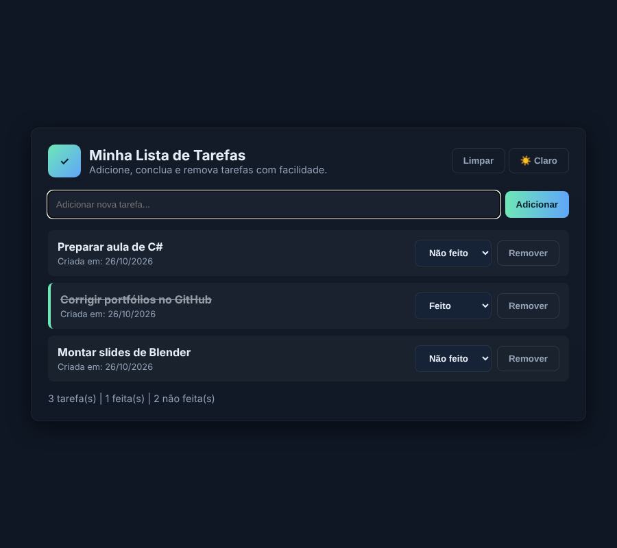

<h1 align="center">Lista de Tarefas</h1>

<p align="center">
  
  
  
  
</p>

<p align="center">
  Aplicação web de lista de tarefas com back-end em <b>Python (Flask)</b> e front-end em<br>
  HTML, CSS e JavaScript, comunicando-se por uma <b>API REST</b>.
</p>

<p align="center">
  
</p>

---

## Funcionalidades

- Adicionar tarefas (pelo botão ou com **Enter**)
- Marcar como **feita** ou **não feita**
- Remover uma tarefa ou **limpar todas**
- Data de criação de cada tarefa
- Contador de tarefas totais, feitas e não feitas
- **Tema claro e escuro**, lembrado pelo navegador
- Tarefas salvas em arquivo: continuam lá mesmo depois de fechar o servidor

## API

O front-end conversa com o back-end usando `fetch` e JSON:

| Método   | Rota              | O que faz                        |
| :------- | :---------------- | :------------------------------- |
| `GET`    | `/tarefas`        | Lista todas as tarefas           |
| `POST`   | `/tarefas`        | Cria uma nova tarefa             |
| `PUT`    | `/tarefas/<id>`   | Marca a tarefa como feita ou não |
| `DELETE` | `/tarefas/<id>`   | Remove uma tarefa                |
| `DELETE` | `/tarefas`        | Remove todas as tarefas          |

Exemplo de tarefa:

```json
{
  "id": 1,
  "texto": "Estudar Flask",
  "feito": false,
  "data": "26/10/2026"
}
```

## Estrutura

```
lista-de-tarefas/
├── app.py               # Back-end (Flask) e rotas da API
├── requirements.txt     # Dependências do Python
├── templates/
│   └── index.html       # Página principal
└── static/
    ├── css/style.css    # Estilos e temas
    └── js/script.js     # Comunicação com a API e interface
```

> O arquivo `tarefas.json` é criado automaticamente na primeira tarefa adicionada.

## O que o projeto pratica

- Criação de uma **API REST** com Flask (`GET`, `POST`, `PUT`, `DELETE`)
- Leitura e gravação de dados em **JSON**
- Requisições assíncronas com `fetch`, `async` e `await`
- Criação de elementos dinamicamente com o **DOM**
- Variáveis CSS para alternar entre temas e `localStorage` para lembrar a escolha
